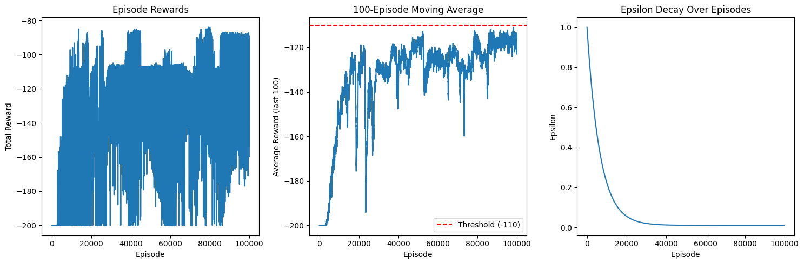
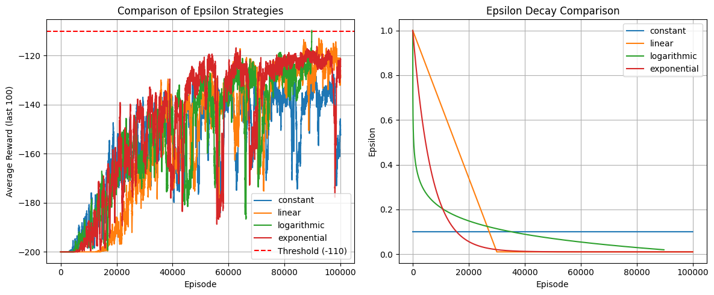
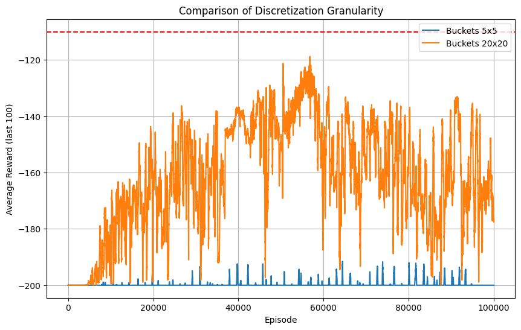
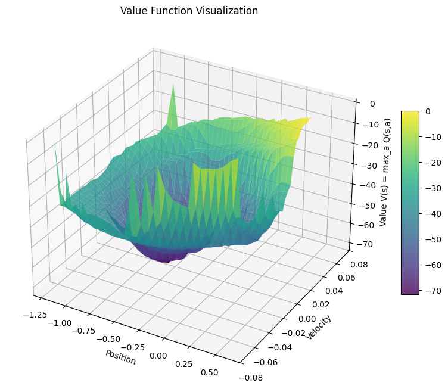
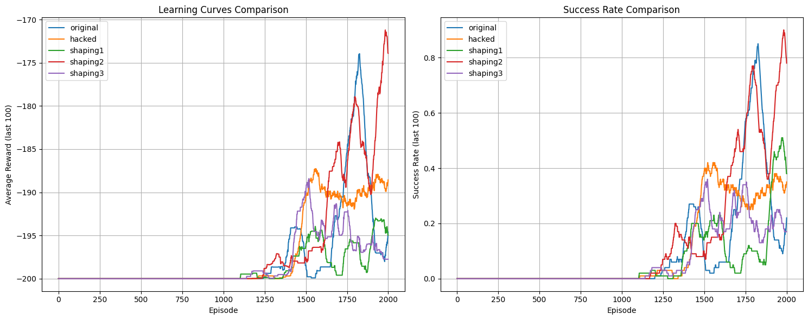

# Q-Learning on MountainCar

Tabular **Q-Learning** applied to the classic `MountainCar-v0` environment
(gymnasium), with discretized state space, multiple ε-decay strategies,
value-function visualization, and a reward-shaping bonus.

## Academic Context

- **Course:** Artificial Intelligence
- **Institution:** School of Electrical and Computer Engineering, University of Tehran
- **Format:** executed Python-kernel notebook (`qlearning_mountain_car.ipynb`)

## Project Overview

| Part | Topic |
|---|---|
| Part 1 | Agent implementation: `QLearningAgent` with discretized state buckets |
| Part 2 | Training over 100,000 episodes: episode rewards, 100-episode moving average, ε decay curves |
| Part 3 | Evaluation of the trained (greedy) agent |
| Part 4 | Experiments: ε strategies (exponential decay vs. fixed) and discretization granularity |
| Part 5 | 3D visualization of the learned value function |
| Part 6 (Bonus) | Reward shaping |

## 📈 Key Visualizations

Selected outputs from the committed notebook — the full set of plots, logs
and metrics is embedded in the notebook itself.


*Training progress over 100,000 episodes: episode rewards, 100-episode moving average and the ε schedule.*


*Comparison of ε strategies (exponential decay vs. fixed) at the same episode budget.*


*Effect of the state-grid granularity on learning performance.*


*Learned value function over the discretized (position, velocity) state space.*


*Reward-shaping (bonus) experiment: learning curves under shaped rewards.*

## Methods

- **Tabular Q-learning** update with learning rate α, discount factor γ, and
  decaying ε-greedy exploration.
- State discretization of the (position, velocity) space into
  **(40 × 40) buckets**.
- ε strategies: exponential decay vs. fixed ε, compared by the
  100-episode average score.
- Effect of discretization granularity on learning speed and final policy.
- Value function surfacing over the discretized state space; reward shaping
  to speed up convergence.

## Technologies and Tools

- **Language:** Python (Jupyter Notebook / Google Colab)
- **Packages:** `gymnasium` (environment), `numpy`, `matplotlib`
- `pygame` only for the optional `render_mode="human"` visualization cell.

## Repository Structure

```text
ai-qlearning-mountain-car/
├── README.md
├── qlearning_mountain_car.ipynb          # notebook with training logs, plots, and evaluations
└── requirements.md
```

## How to Run

```bash
pip install gymnasium numpy matplotlib
jupyter notebook qlearning_mountain_car.ipynb
```

- No external data files are needed; the environment is created with
  `gym.make('MountainCar-v0')`.
- The rendering cell uses `gym.make("MountainCar-v0", render_mode="human")`
  and requires `pygame` plus a display; it is optional.
- **Note:** training runs 100,000 episodes and takes several minutes to
  hours depending on the machine; committed outputs contain the full
  training logs.

## Dependencies

See [`requirements.md`](requirements.md).

## Results and Key Findings

All findings below come from the executed notebook.

- **Learning progress:** with exponential ε decay the 100-episode average
  score starts pinned at the worst-case **-200** and improves steadily,
  reaching roughly **-160** late in training (log in the notebook), with
  evaluation episodes finishing in about **-105** steps.
- **ε strategy comparison:** a fixed ε = 0.1 learns noticeably slower than
  exponential decay at the same episode budget; the comparison plots are in
  the notebook.
- **Discretization granularity:** finer buckets trade sample efficiency
  against final policy quality; results of the granularity experiments are
  tabulated/plotted in Part 4.
- **Value function (Part 5):** the learned value surface shows the classic
  MountainCar structure — the agent must first move away from the goal to
  build momentum.
- **Reward shaping (bonus):** shaped rewards accelerate early learning
  (Part 6 plots).

## Attribution

Assignment statement, part structure, and point breakdown are course
material; the agent implementation, experiments, and analysis are the
student's work for this project.
